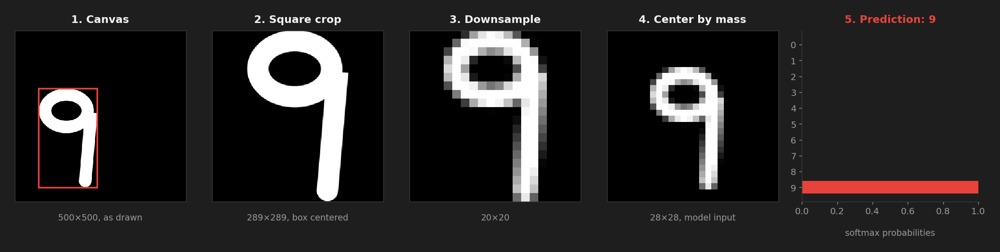
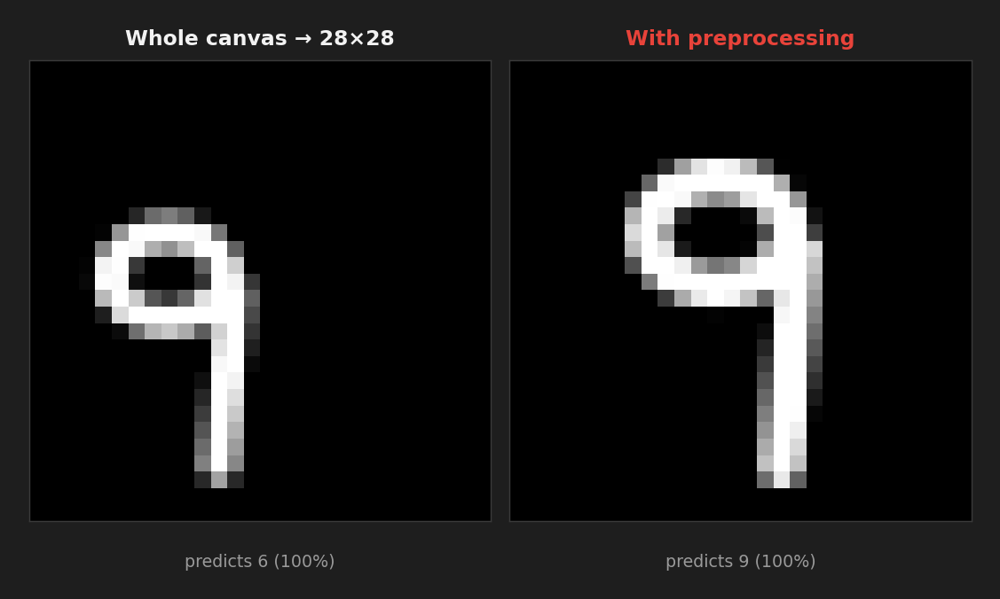
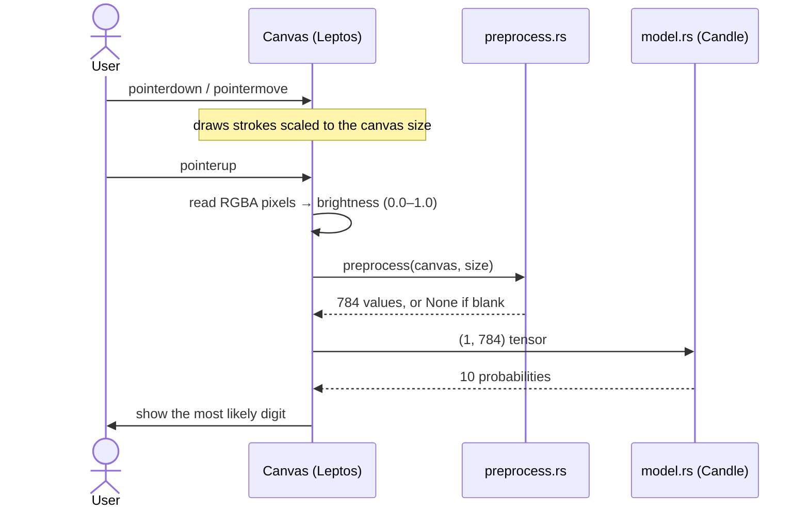
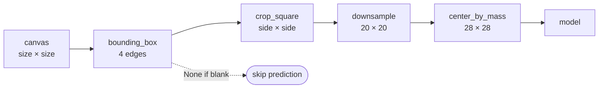
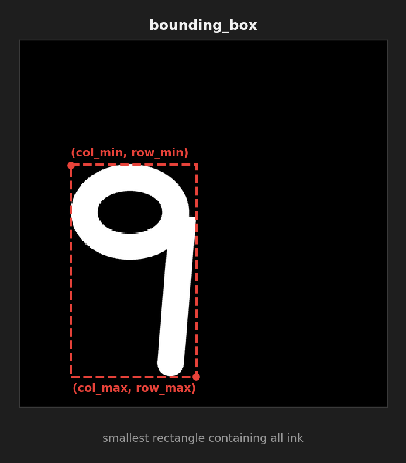
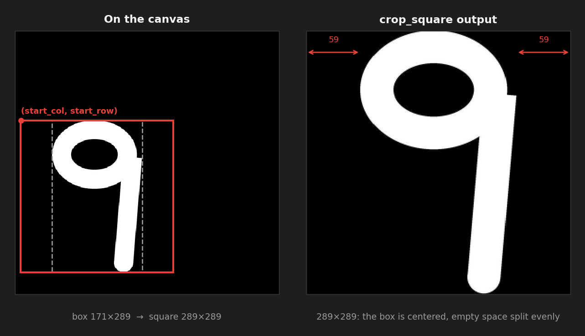
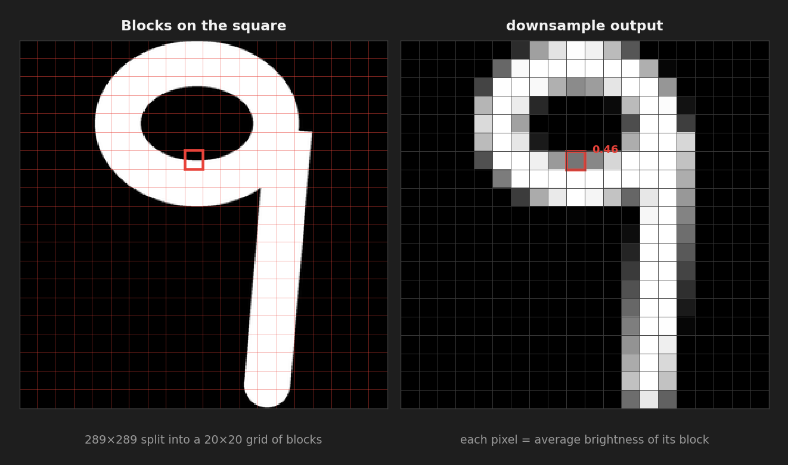
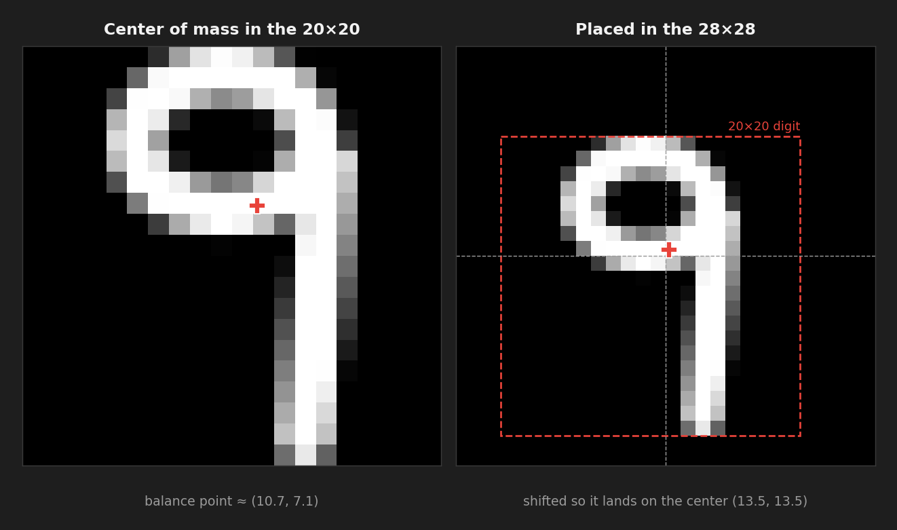
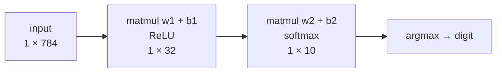

# Diglet

**A handwritten digit recognizer that runs entirely in your browser, written in Rust and compiled to WebAssembly.**

[](https://www.rust-lang.org/)
[](https://leptos.dev/)
[](https://github.com/huggingface/candle)
[](https://webassembly.org/)

Draw a digit and Diglet predicts it the moment you lift your pen. The neural network runs client-side through [Candle](https://github.com/huggingface/candle), with its weights compiled into the WebAssembly binary, so there's no server and no API call.



## Highlights

- Runs a 784 → 32 → 10 neural network in the browser with Candle, with weights embedded via `include_bytes!`
- Prepares every drawing the way MNIST was prepared: cropped, fit into a 20×20 box, and centered by center of mass in 28×28
- Shrinks images with area averaging, so thin strokes survive and edges come out gray like MNIST digits
- Works with mouse, touch, and pen through pointer events, and stays sharp on high-DPI screens

## Why Preprocessing Matters

The model was trained on MNIST, where every digit is the same size and centered. Real drawings aren't. And because the network is fully connected, every input pixel has its own weights: a digit drawn a few pixels off from where MNIST digits sit lights up different inputs and reads as a different number.



To measure it, I took 300 MNIST digits, shrank them, and placed them in the top-right corner of a 500×500 canvas, the way someone might draw small and off to one side:

| Input to the model | Accuracy |
|--------------------|----------|
| Whole canvas shrunk straight to 28×28 | 9% |
| **After Diglet's preprocessing** | **94%** |

## How It Works



When the pen lifts, the canvas's pixels are read back and converted to one brightness value each. The canvas's internal resolution is its display size times the device pixel ratio, and that size is always read from the canvas itself, so everything downstream works at any resolution.

### The preprocessing pipeline



Each step does one job, and each one's output feeds the next.

#### 1. `bounding_box`: find the digit



Scans every canvas pixel and keeps the outermost positions where the brightness is above a small ink threshold. The minimums start at `usize::MAX` and the maximums at `0`, so the first ink pixel replaces all four. If they're never replaced, the canvas is blank and the function returns `None`.

#### 2. `crop_square`: cut it out without distorting it



Grows the box into a square using its longer side, then moves the square's corner back by half the leftover space so the box sits in the middle. Keeping it square means a tall, thin "1" stays thin when it's resized instead of being stretched. The corner can land off the canvas near the edges, so it's computed as a signed integer, and anything off the canvas stays background.

#### 3. `downsample`: shrink to MNIST's 20×20



Splits the square into a 20×20 grid of blocks and averages each block into one pixel. Block boundaries use integer division (`row * src / dst`), so they fit any source size, even when blocks come out uneven on high-DPI screens. Averaging instead of sampling one pixel per block is what keeps thin strokes from disappearing.

#### 4. `center_by_mass`: position it like MNIST



Finds the digit's center of mass, the brightness-weighted average row and column, and pastes the 20×20 into a blank 28×28 so that point lands on the center (13.5, 13.5). MNIST was built this way, so a top-heavy "7" or a bottom-heavy "6" ends up exactly where the model expects it. The shift is rounded to whole pixels and clamped so the digit always stays inside the frame.

### The model



A two-layer network trained in JAX in a separate project, [MNIST Digit Classifier](https://github.com/r-Dev03/MNIST-Digit-Classifier). Its weights were exported to `public/weights.safetensors` and loaded with Candle's safetensors reader.

## Project Structure

```
.
├── src/
│   ├── main.rs        # Leptos UI: canvas, pointer events, reading pixels, running inference
│   ├── preprocess.rs  # bounding_box → crop_square → downsample → center_by_mass
│   └── model.rs       # loads the weights and runs the forward pass
├── public/
│   ├── style.css
│   └── weights.safetensors
├── docs/              # README images
├── index.html         # Trunk entry point
└── flake.nix          # Nix dev environment (Rust, wasm target, Trunk)
```

## Getting Started

**With Nix:**

```bash
git clone https://github.com/r-Dev03/diglet.git
cd diglet
nix develop
trunk serve --open
```

**Without Nix**, install Rust, then:

```bash
rustup target add wasm32-unknown-unknown
cargo install trunk
trunk serve --open
```

Trunk builds the WebAssembly bundle and serves it at `http://localhost:8080`. The browser console prints an ASCII view of the 28×28 image the model receives, which is handy for seeing exactly what it sees.

## Tech Stack

Rust · Leptos · Candle · WebAssembly · Trunk · Nix

## Known Limitations

- **No held-out test set yet.** The training script uses all 70,000 MNIST images, so there's no separate test accuracy to report. Next: train on the standard 60,000 and evaluate on the remaining 10,000.
- **Small model.** A 32-neuron hidden layer is light enough for the browser, but it confuses similar shapes (4 and 9, 7 and 1) more often than a convolutional network would.
- **Canvas size is set on load.** Rotating a phone or resizing the window after the page loads needs a reload.

## License

[MIT](LICENSE)
